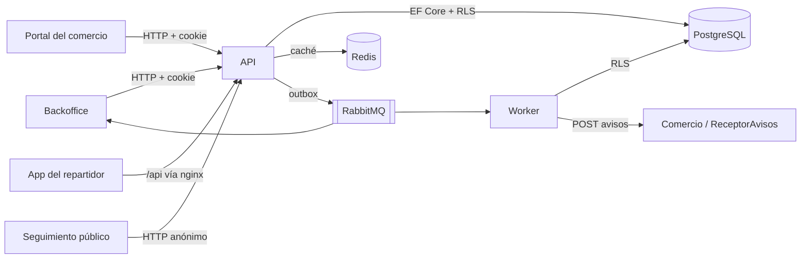

# LastMileUY

Plataforma de última milla **multi-operador**: varios operadores logísticos comparten el sistema. Cada operador trabaja con sus comercios, sus repartidores y sus envíos, y no ve los de los demás.

Proyecto del Taller de Sistemas de Información .NET (UTEC).

## Componentes

| Proyecto | Qué es | Quién lo usa | Puerto en `compose.yaml` |
|---|---|---|---|
| `LastMileUY.API` | API REST (minimal APIs + EF Core + Identity). Toda la lógica y los datos pasan por acá | Las demás aplicaciones | 8080 |
| `LastMileUY.Backoffice` | Razor Pages: envíos, hojas de ruta, sincronización, tablero en vivo (SignalR) y configuración del operador | Operador, despachador | 8081 |
| `LastMileUY.CommercePortal` | Blazor Server: alta y listado de envíos, suscripciones a avisos | Comercio | 8082 |
| `LastMileUY.DriverPWA` | Blazor WebAssembly instalable, funciona sin conexión | Repartidor | 8083 |
| `LastMileUY.PublicTracking` | Página pública de seguimiento por código | Destinatario | 8084 |
| `LastMileUY.Worker` | Servicio en segundo plano: consume los eventos de RabbitMQ y manda los avisos HTTP a los comercios | — | — |
| `LastMileUY.ReceptorAvisos` | Hace de comercio en desarrollo: recibe los avisos y puede simular errores o demoras | Desarrollo y pruebas | 8085 |
| `LastMileUY.Contracts` | DTOs y contratos compartidos (pedidos, respuestas, eventos) | Todos | — |

Infraestructura: PostgreSQL 17 (5432), Redis (6379) y RabbitMQ (5672, consola en 15672).

## Cómo se conectan



- **Una sola API.** El Backoffice y el portal no tocan la base: llaman a la API desde su servidor y le reenvían la cookie de sesión del usuario.
- **Eventos con outbox.** Cuando cambia un envío, el evento se guarda en la misma transacción que el cambio (`MensajesOutbox`) y un publicador lo manda después a RabbitMQ. Así no hay cambios sin evento ni eventos sin cambio. El worker los usa para los avisos a comercios y el Backoffice para el tablero en vivo.

## Aislamiento entre operadores (ADR-01)

Todos los operadores comparten la misma base de datos. Cada fila sabe de qué operador es (`OperadorId`), y el aislamiento se aplica en dos capas:

1. **EF Core**: un filtro global agrega `OperadorId = <el de la sesión>` a cada consulta (y `ComercioId` para usuarios de comercio).
2. **PostgreSQL (RLS)**: cada conexión carga el operador con `set_config('app.operador_id', …)` y las políticas de la base filtran las filas. La API se conecta con un usuario sin privilegios (`lastmileuy_app`) que no puede saltearse el RLS. Si alguien olvida un filtro en el código, la base igual lo frena.

Las migraciones corren con otro usuario, dueño de las tablas (`ConnectionStrings:Migraciones`).

## Levantar todo con Docker

1. Copiar `.env.example` a `.env` y completar los valores: contraseña de PostgreSQL y emails/contraseñas de los usuarios de prueba.
2. Levantar:

   ```bash
   docker compose up -d --build
   ```

La API aplica las migraciones al arrancar. En `Development` también crea datos de prueba: dos operadores, sus comercios, destinatarios, reglas operativas, vehículos y un operador, un despachador y un repartidor por operador. Sus emails salen del dominio de `SeedOperadorPrueba__Email` (por ejemplo `despachador@…`, `repartidor2@…`) y usan la misma contraseña.

`compose.dev.yaml` es para trabajar en el Backoffice con recarga en caliente y la API con https.

## Pruebas

```bash
dotnet test LastMileUY.slnx
```

Hace falta **Docker andando**: las pruebas de la API y del worker levantan PostgreSQL y RabbitMQ reales con Testcontainers. Las de punta a punta (`tests/LastMileUY.API.Tests/PuntaAPunta`) arrancan la API completa y le hablan por HTTP con los usuarios de los seeders.

El CI (`.github/workflows/ci.yml`) compila y corre todas las pruebas con cobertura en cada PR.

## Documentación por módulo

| Documento | Tema |
|---|---|
| [docs/hojas-de-ruta.md](docs/hojas-de-ruta.md) | Planificación y despacho de rutas, hoja del repartidor |
| [docs/sincronizacion.md](docs/sincronizacion.md) | Entregas registradas sin conexión: reglas y política de conflictos |
| [docs/datos-locales.md](docs/datos-locales.md) | Qué guarda la app del repartidor en el celular y cómo lo protege |
| [docs/seguimiento-publico.md](docs/seguimiento-publico.md) | Página pública de seguimiento |
| [docs/mensajeria.md](docs/mensajeria.md) | Outbox, RabbitMQ, worker, avisos HTTP a comercios |
| [docs/seguridad.md](docs/seguridad.md) | Autenticación, permisos, validación de entradas, SSRF y pendientes conocidos |

## Antes de desplegar fuera de desarrollo

- `ASPNETCORE_ENVIRONMENT` distinto de `Development`: sin seeders de prueba ni documentación de la API (Scalar).
- `Avisos__PermitirDestinosLocales` en `false` (API y worker). Si no, un comercio podría apuntar los avisos a la red interna.
- Cambiar las contraseñas de los usuarios de base `lastmileuy_app` y `lastmileuy_publicador`: las crean las migraciones con valores de desarrollo.
- Configurar `RABBITMQ_PASSWORD`.
- Persistir las claves de Data Protection (`DataProtection__Directorio`, ya en volúmenes en `compose.yaml`) para que las sesiones sobrevivan a un reinicio.
- La selección de operador al iniciar sesión (token temporal de 5 minutos) vive en la memoria de la API: con varias instancias hace falta afinidad de sesión o moverla a Redis.
