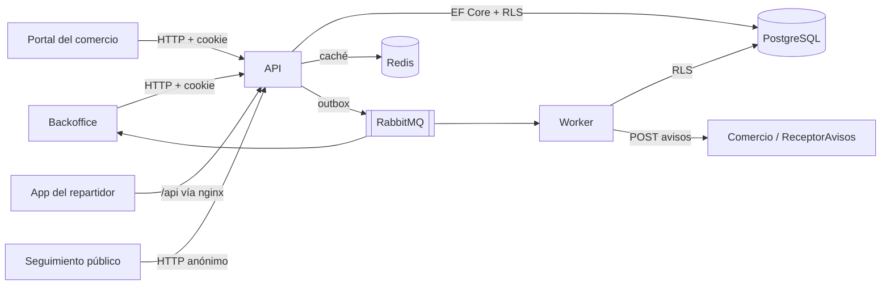

# LastMileUY

Plataforma de última milla **multi-operador**: varios operadores logísticos comparten el sistema. Cada operador trabaja con sus comercios, sus repartidores y sus envíos, y no ve los de los demás.

Proyecto del Taller de Sistemas de Información .NET (UTEC).

## Componentes

| Proyecto | Qué es | Quién lo usa | Puerto en `compose.yaml` |
|---|---|---|---|
| `LastMileUY.API` | API REST (minimal APIs + EF Core + Identity). Toda la lógica y los datos pasan por acá | Las demás aplicaciones | 8080 |
| `LastMileUY.Backoffice` | Razor Pages: envíos, hojas de ruta, sincronización, tablero en vivo (SignalR) y configuración del operador | Operador, despachador | 8081 |
| `LastMileUY.CommercePortal` | Blazor Server: alta y listado de envíos, suscripciones a avisos | Comercio | 8082 |
| `LastMileUY.DriverPWA` | Blazor WebAssembly instalable, funciona sin conexión | Repartidor | 8083 |
| `LastMileUY.PublicTracking` | Página pública de seguimiento por código | Destinatario | 8084 |
| `LastMileUY.Worker` | Servicio en segundo plano: consume los eventos de RabbitMQ y manda los avisos HTTP a los comercios | — | — |
| `LastMileUY.ReceptorAvisos` | Hace de comercio en desarrollo: recibe los avisos y puede simular errores o demoras | Desarrollo y pruebas | 8085 |
| `LastMileUY.Contracts` | DTOs y contratos compartidos (pedidos, respuestas, eventos) | Todos | — |

Infraestructura: PostgreSQL 17 (5432), Redis (6379) y RabbitMQ (5672, consola en 15672).

## Cómo se conectan



- **Una sola API.** El Backoffice y el portal no tocan la base: llaman a la API desde su servidor y le reenvían la cookie de sesión del usuario.
- **Eventos con outbox.** Cuando cambia un envío, el evento se guarda en la misma transacción que el cambio (`MensajesOutbox`) y un publicador lo manda después a RabbitMQ. Así no hay cambios sin evento ni eventos sin cambio. El worker los usa para los avisos a comercios y el Backoffice para el tablero en vivo.

## Aislamiento entre operadores (ADR-01)

Todos los operadores comparten la misma base de datos. Cada fila sabe de qué operador es (`OperadorId`), y el aislamiento se aplica en dos capas:

1. **EF Core**: un filtro global agrega `OperadorId = <el de la sesión>` a cada consulta (y `ComercioId` para usuarios de comercio).
2. **PostgreSQL (RLS)**: cada conexión carga el operador con `set_config('app.operador_id', …)` y las políticas de la base filtran las filas. La API se conecta con un usuario sin privilegios (`lastmileuy_app`) que no puede saltearse el RLS. Si alguien olvida un filtro en el código, la base igual lo frena.

Las migraciones corren con otro usuario, dueño de las tablas (`ConnectionStrings:Migraciones`).

## Levantar todo con Docker

1. Copiar `.env.example` a `.env` y completar los valores: contraseña de PostgreSQL y emails/contraseñas de los usuarios de prueba.
2. Levantar:

   ```bash
   docker compose up -d --build
   ```

La API aplica las migraciones al arrancar. En `Development` también crea datos de prueba: dos operadores, sus comercios, destinatarios, reglas operativas, vehículos y un operador, un despachador y un repartidor por operador. Sus emails salen del dominio de `SeedOperadorPrueba__Email` (por ejemplo `despachador@…`, `repartidor2@…`) y usan la misma contraseña.

`compose.dev.yaml` es para trabajar en el Backoffice con recarga en caliente y la API con https.

## Pruebas

```bash
dotnet test LastMileUY.slnx
```

Hace falta **Docker andando**: las pruebas de la API y del worker levantan PostgreSQL y RabbitMQ reales con Testcontainers. Las de punta a punta (`tests/LastMileUY.API.Tests/PuntaAPunta`) arrancan la API completa y le hablan por HTTP con los usuarios de los seeders.

**Pruebas de navegador** (`tests/LastMileUY.E2E.Tests`, con [Playwright](https://playwright.dev/dotnet/)):
un Chromium real usa el Backoffice como una persona. Hace clic, completa formularios y lee lo que se
ve: inicio de sesión, permisos por perfil, filtros de envíos, armar y despachar una hoja de ruta con el
orden sugerido, el depósito, y que ninguna pantalla se corra de costado en un celular. El Backoffice
arranca con los datos de prueba en memoria, así que esas no necesitan la API ni Docker.

También prueban la **app del repartidor sin conexión**, en el navegador:
- la app publicada en Release, con su service worker, servida como en producción (los archivos de la
  app y `/api` pasado a la API, como hace nginx);
- la API real, con PostgreSQL en Docker;
- con la red cortada, la app se abre igual y se registra una entrega;
- lo pendiente sigue ahí al recargar, y al volver la conexión la app la manda sola.

Y el **portal del comercio**, con la API real: alta de destinatarios y direcciones, alta de envíos, el
listado y el detalle de un envío, y las pantallas de avisos (suscripciones e historial con reenvío).

La primera vez descargan Chromium (unos 150 MB, en la carpeta de Playwright del usuario).

Cubren lo que no ven las pruebas de las páginas: lo que pasa en el navegador entre un pedido y otro.
Al escribirlas encontraron fallas reales:
- quien no tenía permiso veía una página en blanco (404), porque la de "Sin permiso" no estaba en la
  dirección configurada;
- después de "Ordenar por recorrido", el botón "Armar hoja de ruta" volvía a ordenar;
- con los datos de prueba, la página de usuarios del Backoffice daba error (le faltaba su versión en
  memoria), y el aviso de "¿Desactivar usuario?" quedaba fuera de la pantalla (su CSS no estaba generado).

El CI (`.github/workflows/ci.yml`) compila y corre todas las pruebas con cobertura en cada PR. Antes
instala Chromium con sus dependencias del sistema, y comprueba que el CSS de Tailwind esté al día.

## Estilos (Tailwind)

El Backoffice, el portal y la app del repartidor usan Tailwind, y el CSS generado (`tailwind.css` en
`wwwroot`) **va en el repositorio**: así ninguna imagen ni ningún arranque necesita Node. La contra es
que, si una página usa una clase nueva, hay que volver a generarlo; si no, la clase no existe y la
pantalla se ve mal sin ningún error. Desde la carpeta de la aplicación:

```bash
npm ci
npx @tailwindcss/cli -i Styles/input.css -o wwwroot/css/tailwind.css
```

En el portal la salida es `wwwroot/tailwind.css`. El CI falla si el CSS subido no coincide con el que
se genera.

## Documentación por módulo

| Documento | Tema |
|---|---|
| [docs/hojas-de-ruta.md](docs/hojas-de-ruta.md) | Planificación y despacho de rutas, hoja del repartidor |
| [docs/sincronizacion.md](docs/sincronizacion.md) | Entregas registradas sin conexión: reglas y política de conflictos |
| [docs/datos-locales.md](docs/datos-locales.md) | Qué guarda la app del repartidor en el celular y cómo lo protege |
| [docs/seguimiento-publico.md](docs/seguimiento-publico.md) | Página pública de seguimiento |
| [docs/mensajeria.md](docs/mensajeria.md) | Outbox, RabbitMQ, worker, avisos HTTP a comercios |
| [docs/seguridad.md](docs/seguridad.md) | Autenticación, permisos, validación de entradas, SSRF y pendientes conocidos |
| [docs/funcionalidades.md](docs/funcionalidades.md) | Funcionalidades por operador (banderas): cuáles hay, quién las cambia y qué cortan |
| [docs/api-publica.md](docs/api-publica.md) | API pública para comercios: claves, versiones, importación sin duplicados, topes y documentación navegable |

## Antes de desplegar fuera de desarrollo

- `ASPNETCORE_ENVIRONMENT` distinto de `Development`: sin seeders de prueba ni documentación de la API (Scalar).
- `Avisos__PermitirDestinosLocales` en `false` (API y worker). Si no, un comercio podría apuntar los avisos a la red interna.
- Cambiar las contraseñas de los usuarios de base `lastmileuy_app` y `lastmileuy_publicador`: las crean las migraciones con valores de desarrollo.
- Configurar `RABBITMQ_PASSWORD`.
- Persistir las claves de Data Protection (`DataProtection__Directorio`, ya en volúmenes en `compose.yaml`) para que las sesiones sobrevivan a un reinicio.
- La selección de operador al iniciar sesión (token temporal de 5 minutos) vive en la memoria de la API: con varias instancias hace falta afinidad de sesión o moverla a Redis.
